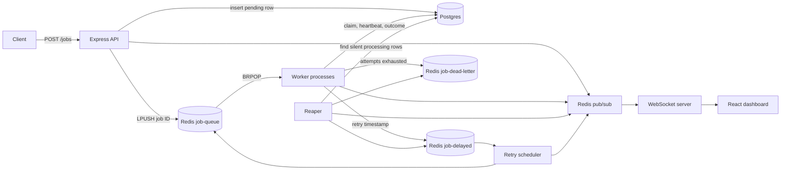

# Job Processing System

A Node.js/TypeScript job service with Express, Postgres, Redis, separate worker
processes, crash recovery, WebSocket updates, and a React dashboard.

## Setup

Requires Node.js 22.12+ (or a supported newer LTS), npm, and Docker Desktop.

```sh
npm install
npm install --prefix dashboard
# Preserve an existing .env:
test -f .env || cp .env.example .env
docker compose up -d --wait
npm run db:migrate
```

Run each of these in its own terminal from the project root:

```sh
npm run dev
npm run worker:dev
npm run reaper:dev
npm run dashboard:dev
```

The API is at http://localhost:3000, the dashboard at http://localhost:5173, and
WebSocket events at ws://localhost:3000/ws. The API root is not a web page.
The dashboard's Vite proxy forwards its API and WebSocket requests to port 3000.

For a production-style local run: `npm run build`, then separately run
`npm start`, `npm run worker:start`, and `npm run reaper:start`.
`npm run dashboard:build` creates static assets; production hosting must proxy
`/jobs`, `/stats`, and `/ws` to the API. Vite's development proxy is not production hosting.

## Data flow



Postgres stores durable job state. Redis transports IDs, schedules retries, and
broadcasts updates. Job state is never reconstructed solely from a Redis list.
`src/api`, `src/db`, `src/queue`, `src/workers`, `src/reaper`, `src/events`,
`src/logging`, and `src/metrics` separate the responsibilities.

## API and testing manually

```sh
curl -i http://localhost:3000/health
curl -i -X POST http://localhost:3000/jobs \
  -H 'Content-Type: application/json' -H 'X-API-Key: local-test' \
  -d '{"type":"fail-then-succeed","payload":{},"max_attempts":3}'
```

Copy the returned UUID into `JOB_ID`, then:

```sh
JOB_ID=replace-with-returned-uuid
curl -s "http://localhost:3000/jobs/$JOB_ID" | python3 -m json.tool
curl -s http://localhost:3000/stats | python3 -m json.tool
curl -s http://localhost:3000/metrics | python3 -m json.tool
```

- `POST /jobs`: validates a nonempty type, object payload, and optional positive
  integer `max_attempts` (default 3). Invalid input creates no job. Returns 201.
- `GET /jobs/:id`: returns current details, 400 for malformed UUIDs, 404 for unknown UUIDs.
- `GET /jobs?limit=100`: latest jobs, maximum 500; used for dashboard hydration.
- `GET /stats`: queue depth, in-progress jobs, completed jobs, and Redis dead-letter count.
- `GET /health`: readiness, not merely process liveness. Runs `SELECT 1` and Redis
  `PING`, returning 200 only if both respond; 503 names failed dependencies.
  Probes have a two-second response deadline. A container orchestrator can use a
  separate process/TCP liveness check so database downtime does not cause restart loops.
- `GET /metrics`: durable, shared rolling 60-second metrics. See
  [definitions and SQL cross-check](docs/metrics.md).
- `/ws`: broadcasts created, processing, completed, failed, dead and retry events
  with a job (including ID and status) and a timestamp. Supports multiple clients,
  ping/pong cleanup, and disconnects. Dashboard reconnects reload current jobs.

Types `test-success` (20ms sleep), `always-fail`, and `fail-then-succeed` (fails on
attempt 1, succeeds on attempt 2) are deterministic test handlers. Other types use
an abortable random 500–3000ms sleep and `MOCK_FAILURE_RATE` (default 0.1).

## Design decisions

**Postgres:** the jobs table uses random UUIDs to avoid a central ID generator,
JSONB for flexible payloads, and an enum to reject invalid statuses. UUIDs cost
more index space than integer IDs; enums require a migration when adding states.
Edit the Drizzle schema, run `npm run db:generate`, inspect the SQL, then
`npm run db:migrate`. Commit migrations and Drizzle metadata together.
`job_attempts` preserves attempt timings despite heartbeats; a database trigger
records transitions atomically with status writes for metrics.

**Redis and BRPOP:** `LPUSH` plus `BRPOP` is FIFO. A blocking pop waits server-side,
reducing idle command traffic and polling latency. Each worker needs a dedicated
blocking connection. A one-second timeout permits shutdown checks. The sorted-set
retry scheduler checks due timestamps every 500ms and atomically transfers IDs
back to the list with Lua. Concurrent schedulers cannot transfer one member twice.
`RPUSH` plus `BRPOP` would be LIFO, despite an earlier explanation to the contrary.

**Claims and attempt ownership:** the pool forks `WORKER_COUNT` processes (default
4); each handles one attempt at a time. The supervisor restarts a crashed child.
BRPOP removes a list entry atomically, but duplicate IDs can still exist in the
list. A conditional Postgres UPDATE claims only pending/failed jobs and increments
attempts atomically. Heartbeat and final updates require both processing status
and that attempt number. A stale worker cannot overwrite a newer attempt's state.

**Attempts and backoff:** attempts count execution starts, including a crashed
start. They increment once at claim, not twice on failure. `max_attempts=3` means
at most three executions. A retryable failure has status `failed` while waiting.
Delay is uniform full jitter from 0 to
`min(RETRY_MAX_DELAY_MS, RETRY_BASE_DELAY_MS * 2^(attempts-1))` milliseconds,
rounded to an integer. Defaults are 1000ms base and 60000ms cap. Actual eligibility
may be up to a scheduler interval later, plus load-dependent queue delay. Final
failures become `dead` and enter `job-dead-letter`; they never retry automatically.

**Visibility timeout and heartbeat:** the separate reaper checks every 10 seconds
for processing rows with no timestamp update in 30 seconds. Workers heartbeat
every 10 seconds. Set `PROCESSING_TIMEOUT_MS` at least 2–3 times
`HEARTBEAT_INTERVAL_MS`. Both use the Postgres clock. Silence consumes the already
counted attempt and routes through retry/dead-letter rules. Long jobs that keep
heartbeating are not reclaimed just because of their age.

**Execution timeout:** each attempt has a 60-second `JOB_TIMEOUT_MS` deadline.
The handler receives an AbortSignal; the mock sleep honors it. Promise.race routes
non-cooperative asynchronous timeouts through ordinary failure handling. The
heartbeat stops before the outcome is written. A synchronous CPU loop blocks a
child's event loop and therefore its timer too; the independent reaper can detect
its missing heartbeat. Use external process supervision for forcibly terminating
unresponsive processes and idempotency for handlers with external effects.

**Token bucket:** POST limits burst size and sustained rate while allowing natural
bursts. Lua uses Redis time and atomic updates, so the limiter works across API
instances. Defaults: 20-token burst, refill 2 tokens/second. Keys use a hash of
`X-API-Key`, falling back to IP, with an idle expiry. Rejections return 429 and
`Retry-After`. Limiter errors fail open; a Redis enqueue outage still prevents a
successful submission. API keys identify buckets; they are not authentication.

**Structured logs:** every application log line is JSON with timestamp, event,
level, process_id, job_id and worker_id (null where not applicable), plus contextual
fields such as attempt, delay_ms, and error. Search a job UUID across API, worker,
scheduler and reaper logs to trace it. Payloads and API key values are not logged.

## Automated verification

```sh
npm run typecheck
npm test
npm run test:metrics
npm run dashboard:build
```

Tests require running Postgres and Redis, the URLs in `.env`, and a Postgres user
allowed to create databases. They create/drop a temporary database and remove
only their unique Redis namespace. They never flush shared Redis or delete the
application's jobs. Do not point tests at a production server.

Vitest covers real worker processes and SIGKILL recovery; duplicate queue IDs;
FIFO ordering; retry/success/dead-letter transitions; heartbeat protection and
silence recovery; stale-attempt fencing; execution timeout; validation and lookup;
Redis-backed rate limiting; multiple WebSocket clients; and metrics/stat counts.
The separate metrics test uses four known durations and compares HTTP with raw
SQL, including empty windows and exclusion of old/unfinished attempts.

## Load tests

`npm run load:k6` uses the full varying-rate profile (about 6.5 minutes and over
5000 submission attempts). Install k6 or run the script with the k6 Docker image.
Run the profiles separately so the headline throughput is not a limiter result:

```sh
K6_PER_VU_API_KEY=true k6 run load/k6/submit-jobs.js
K6_PER_VU_API_KEY=false k6 run load/k6/submit-jobs.js
```

For reproducible isolated local benchmarks, `npm run load:local` uses Docker k6,
a temporary API port/database, and namespaced Redis keys. Each profile ramps
0 → 100 → 200 → 100 attempts/sec over 30 seconds (about 3500 attempts). It compares
accepted counts against completed rows in Postgres before removing test data.
The throughput run uses per-VU keys and a generous limiter (2000 burst, 1000/sec)
to isolate processing capacity. The limiter run uses one shared key and the normal
20 burst/2 per second. Both use 16 worker processes and the 20ms deterministic
handler; these numbers do not predict throughput for the random 0.5–3s handler.
Raw k6 summaries and independent verification records are in `load/results`.

Measured results are recorded in [load-test results](docs/load-results.md), with
profile, environment, p95 latency, drops and timeout counts. Per-VU keys alone
do not guarantee bypassing rate limits if a VU exceeds its own bucket. Completion
latency includes the polling interval and is distinct from handler duration.
The full default profile has not been measured as part of this verification.

## Known limitations

- Postgres and Redis do not share a transaction. Crashes between DB updates and
  queue writes, or between BRPOP and the database claim, can orphan work. The
  reaper recovers processing rows; it does not reconcile pending/failed rows.
  A transactional outbox plus a dispatcher/reconciler is needed for stronger delivery.
- Attempt fencing protects database state, not exactly-once external side effects.
  Use idempotency keys; an old handler can keep running after losing ownership if
  it ignores cancellation. AbortSignal cannot forcibly stop arbitrary code.
- Redis Compose persistence uses AOF plus a named volume; default every-second
  fsync can lose recent writes on abrupt host failure. Postgres remains the state store.
- Pub/sub is ephemeral and is not transactionally coupled to status changes.
  Reconnect reloads a snapshot, but clients may miss events during outages. The
  dashboard shows the most recent 100 jobs initially and has no pagination UI.
- Metrics begin with the attempt-history migration; old timings cannot be backfilled.
  Metrics count finished attempts, and retry/dead-letter rates reflect database
  decisions rather than verified Redis delivery. No history retention policy yet.
- This is a local project scaffold: there is no authentication, TLS, tenant
  isolation, schema versioning for payloads, or production deployment automation.
- The development-only Drizzle tooling dependency has an upstream esbuild audit
  advisory; breaking automated downgrades were not applied. Audit dependencies
  before deploying tooling or exposing its development servers.

## Git workflow

Keep schema, migration and metadata together; use conventional commits after a
verified change, for example `feat(observability): add durable job metrics` or
`fix(workers): fence stale attempts`. Existing staged work is preserved; this
review does not invent historical commits for earlier prompts or rewrite history.
